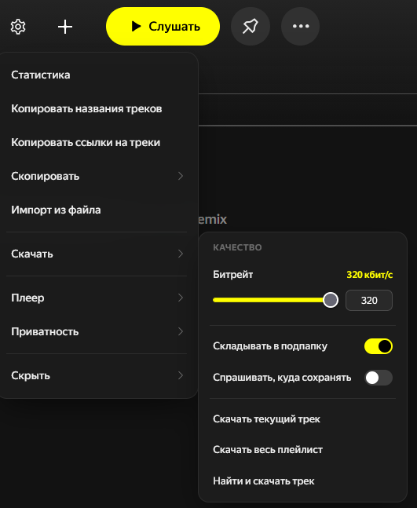

# YMX-tools 🎵

Расширение для Яндекс Музыки: скачивание треков, работа с плейлистами, настройки волны и плеера.

## Возможности

**Скачивание**

- MP3 с ID3-тегами и обложкой, битрейт от 96 до 320 кбит/с или максимум
- Кнопка «Скачать» у каждого трека, из плеера, из всплывающего окна или через поиск по названию
- Весь плейлист одним ZIP с прогрессом и отменой по Esc
- Необязательно: подпапка с названием плейлиста и выбор папки при сохранении

**Плейлисты**

- Статистика: треки, длительность, артисты, топ-10
- Экспорт: названия и ссылки в буфер, а также `.txt`, `.csv`, `.json`
- Импорт из файла или по ссылке на трек, альбом, плейлист
- Добавление треков в свои плейлисты с показом уже добавленных
- Даты треков и переход к треку прямо в списке

**Волна**

- Скрытие лайков из волны
- Не повторять недавние треки — окно памяти настраивается ползунком
- Счётчик скрытых треков с разбивкой на лайки и недавние

**Плеер и интерфейс**

- Качество звука: превосходное, оптимальное, экономичное
- Выборочное скрытие лишних блоков страницы
- Ровные обложки и исправленный заголовок трека в волне

**Приватность**

- Блокировка телеметрии Яндекса, включена по умолчанию

**Всплывающее окно**

- Что играет сейчас, сохранение трека и плейлиста, качество звука, быстрые переключатели

## Установка

1. Собрать расширение: `python build.py`
2. Открыть в Firefox `about:debugging#/runtime/this-firefox`
3. «Загрузить временное дополнение» → `YMX-tools.zip`